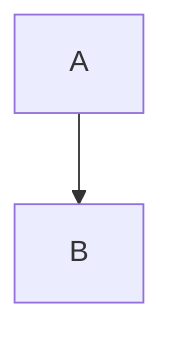

Refs: #1 and #999999 and rust-lang/rust#38356 and tomsjansons/beghu#59 and https://github.com/rust-lang/rust/issues/38356 and @tomsjansons and @rust-lang/libs and GH-1 and 6a10711.

> [!NOTE]
> An alert.

> [!WARNING]
> Careful.

Footnote here[^1].

[^1]: The note.

:+1: :tada:

- [x] done
- [ ] todo




```rust
fn main() { println!("hi"); }
```

| a | b |
|---|:-:|
| 1 | 2 |

<details><summary>More</summary>

hidden **bold**

</details>

<script>alert(1)</script> <span style="color:red" class="foo" id="bar">styled</span> <kbd>Ctrl</kbd> <sub>s</sub> <picture><source srcset="https://example.com/d.png" media="(prefers-color-scheme: dark)"></picture>
<iframe src="https://example.com"></iframe> <a href="javascript:alert(1)">js</a> <div align="center">c</div>

$x^2$ and ~~strike~~ and www.example.com
